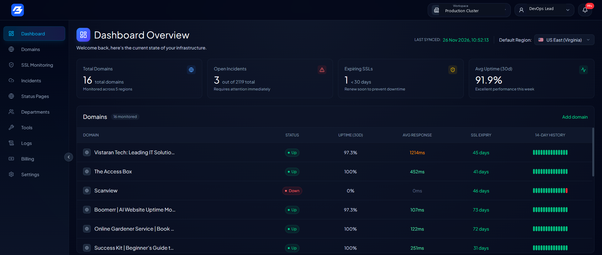
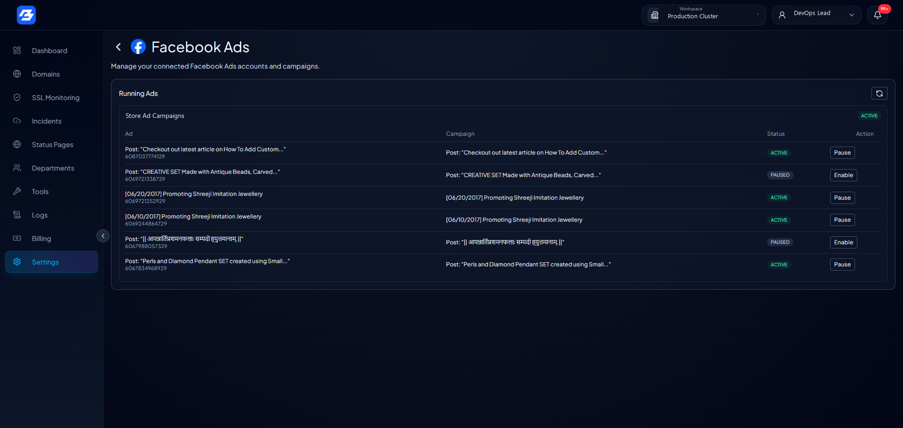

<p align="center">
  
</p>

<h1 align="center">Boomerr - Self-Hosted Website & Domain Monitoring</h1>

<p align="center">
  <strong>An open-source, full-stack website monitoring, SSL tracking, incident diagnosis, and public status page platform with automated Ads Protection.</strong>
</p>

<p align="center">
  <a href="https://github.com/vistaran/boomerr/actions/workflows/ci.yml"></a>
  <a href="https://discord.gg/Sw5rrQ26MP"></a>
  
  
  
  
  
</p>

---

## ⚡ Overview

Boomerr is an open-source, self-hosted website and domain monitoring platform designed for developers, sysadmins, e-commerce brands, agencies, and businesses. Monitor unlimited endpoints, track SSL certificates, pause burning ad spend with automated Ads Protection, diagnose outages with AI-powered root cause analysis, and publish customizable status pages for your users.

Self-hosted Boomerr instances run in **Community Edition** mode with zero paywalls, zero artificial limits, and zero external telemetry.

---

## 📸 Product Tour

<div align="center">

### 📊 Real-Time Operations & Cluster Dashboard
*Monitor all your domains, HTTP response latencies, SSL certificates, and 30-day uptime records in a live unified view.*
<br/>


<br/><br/>

### 🔍 Deep Domain Health & Incident Root Cause Analysis
*Drill into sub-second latency sparklines, review automated AI incident diagnosis, and get instant SEO & performance health audits.*
<br/>


<br/><br/>

### 🌍 Multi-Region Global Edge Monitoring
*Track global latency and uptime from distributed edge probes across North America, Europe, Asia, and Africa.*
<br/>


<br/><br/>

### 🛡️ Automated Ads Protection (Google Ads & Meta Ads)
*Connect your ad accounts. Boomerr automatically pauses active campaigns when a landing page goes down and resumes them upon recovery.*
<br/>


<br/><br/>

### 📢 Branded Public Status Pages
*Share live incident updates and uptime transparency with your users via custom branded public status pages.*
<br/>


</div>

---

## 🆚 Why Boomerr?

How does Boomerr compare to other popular monitoring platforms?

| Feature | Boomerr (Community) | Uptime Kuma | Better Stack | Pingdom |
|---|:---:|:---:|:---:|:---:|
| **Open Source & Self-Hostable** | ✅ Yes (AGPL-3.0) | ✅ Yes (MIT) | ❌ Proprietary | ❌ Proprietary |
| **Ads Protection (Google & Meta)** | ✅ **Native** | ❌ No | ❌ No | ❌ No |
| **AI Root Cause & Incident Diagnostics** | ✅ **Built-in** | ❌ No | ⚠️ Cloud Only | ❌ No |
| **Multi-Region Edge Probes** | ✅ Lambda & Docker | ⚠️ Third-party | ✅ Cloud Only | ✅ Cloud Only |
| **Real-Time WebSockets** | ✅ Native (Laravel Reverb) | ✅ Socket.io | ✅ Cloud Only | ❌ Polling |
| **Multi-Workspace & Role-Based Access** | ✅ Built-in RBAC | ⚠️ Basic single | ✅ Cloud Only | ✅ Paid tiers |
| **Built-in SEO & Performance Auditing** | ✅ Built-in | ❌ No | ❌ No | ❌ No |
| **SSL Handshake & Expiry Tracking** | ✅ X.509 Socket Handshake | ✅ Basic | ✅ Cloud Only | ✅ Cloud Only |
| **Self-Hosted Pricing** | 💚 **100% Free** | 💚 100% Free | 💰 Paid SaaS | 💰 Paid SaaS |

---

## ✨ Features

- 🌐 **High-Frequency Uptime Monitoring:** Sub-minute HTTP/HTTPS ping checks, latency graphs, and response code tracking.
- 🛡️ **Ads Protection Engine (Google Ads & Meta Ads):** Automatically pause Google Ads campaigns and Meta (Facebook) ads the moment a landing page goes down, resuming them automatically upon recovery to prevent burning ad budgets.
- 🔒 **SSL & Domain Certificate Tracking:** Direct socket X.509 handshake monitoring with automated alerts before certificates expire (30d, 14d, 3d).
- 🌍 **Multi-Region Edge Probes:** Packaged Docker and AWS Lambda probe agents to verify uptime and latency globally.
- 📡 **Real-Time WebSockets:** Live dashboard updates via Laravel Reverb without needing external third-party socket services.
- 🤖 **AI & Heuristic Outage Diagnostics:** Integrated LLM root-cause analysis (DeepSeek, OpenAI, or local Ollama) plus offline heuristic performance & SEO auditing.
- 📢 **Multi-Channel Incident Alerts:** Instant notifications via Email (SMTP), Telegram, Discord, Slack, SMS (Twilio/MSG91), and WhatsApp.
- 📄 **Branded Public Status Pages:** Host public or private status pages with custom domains, subscriber email alerts, and incident history feeds.
- 👥 **Multi-Workspace & Team Support:** Role-based access control (Owners, Admins, Members) across independent workspaces.
- 🛠️ **Built-in Diagnostic Web Tools:** Public utilities for SSL inspection, DNS lookup, global DNS propagation, and Shopify store detection.
- 🛡️ **SSRF & Security Hardening:** Hardened URL resolution and private IP blockers to ensure security when testing user-provided URLs.
- 🐳 **One-Command Docker Deployment:** Production-ready multi-container architecture with automated database migrations and health checks.

---

## 🚀 Quickstart in 3 Steps

### Prerequisites
- Docker Engine 24.0+
- Docker Compose v2.20+ (or `docker-compose`)

### 1. Clone the Repository
```bash
git clone https://github.com/vistaran/boomerr.git
cd boomerr
```

### 2. Run the Interactive Setup Script
```bash
chmod +x setup.sh
./setup.sh
```

The script will automatically validate prerequisites, configure `.env`, start the Docker containers, run database migrations, and prompt you to create an administrator user.

### 3. Open the Dashboard
Navigate to `http://localhost:8080` in your browser. Log in with the administrator credentials created during setup.

---

## 🛠️ Management CLI Commands

Boomerr includes powerful artisan commands for self-hosters:

| Task | Command |
|---|---|
| **System Health Check** | `docker compose exec api php artisan boomerr:doctor` |
| **Create Admin Account** | `docker compose exec api php artisan boomerr:admin:create` |
| **View Live Logs** | `docker compose logs -f` |
| **Run Migrations** | `docker compose exec api php artisan migrate --force` |
| **Clear Caches** | `docker compose exec api php artisan config:clear && docker compose exec api php artisan route:clear` |

---

## 📦 Docker Architecture

```
                    [ Port 8080 (HTTP) ]
                             │
                             ▼
                    ┌─────────────────┐
                    │  web (Nginx)    │
                    └───┬─────────┬───┘
                        │         │
             /api/*     ▼         ▼     /app/* (WebSockets)
        ┌─────────────────┐     ┌──────────────────┐
        │  api (PHP-FPM)  │     │ reverb (Sockets) │
        └───────┬─────────┘     └────────┬─────────┘
                │                        │
       ┌────────┴────────┐               │
       │ worker / sched. │               │
       └────────┬────────┘               │
                ├────────────────────────┤
                ▼                        ▼
        ┌─────────────────┐     ┌──────────────────┐
        │ db (MariaDB 11) │     │ redis (Redis 7)  │
        └─────────────────┘     └──────────────────┘
```

---

## 📚 Documentation

Detailed guides are available in the [`docs/`](docs/) directory:

- 🛡️ [Ads Protection Guide (Google & Meta Ads)](docs/ads-protection-guide.md)
- 🌍 [Edge Monitoring Probes Guide](docs/edge-monitoring-guide.md)
- 🐳 [Docker Deployment & Production SSL Guide](docs/docker-deployment.md)
- ⚙️ [Configuration Reference (.env)](docs/configuration-reference.md)
- 🔧 [Troubleshooting & FAQ](docs/troubleshooting.md)
- 💾 [Backup & Disaster Recovery](docs/backup-restore.md)

---

## 🤝 Contributing

We welcome community contributions, bug reports, and pull requests! Please ensure any code changes include relevant unit or feature tests. See [CONTRIBUTING.md](CONTRIBUTING.md) for details.

---

## 💬 Community & Support

Join our growing community of developers, sysadmins, and self-hosters:

- 💬 **Discord:** Join the [Boomerr Discord Community](https://discord.gg/Sw5rrQ26MP) for real-time discussion, troubleshooting, and feature previews.
- 💡 **GitHub Discussions:** Ask questions or suggest ideas in [GitHub Discussions](https://github.com/vistaran/boomerr/discussions).
- 🐛 **Issue Tracker:** Report bugs or submit feature requests on [GitHub Issues](https://github.com/vistaran/boomerr/issues).

---

## ⭐ Star History

[](https://star-history.com/#vistaran/boomerr&Date)

---

## 📄 License

Boomerr is open-source software licensed under the **GNU Affero General Public License v3.0 (AGPL-3.0)**.
