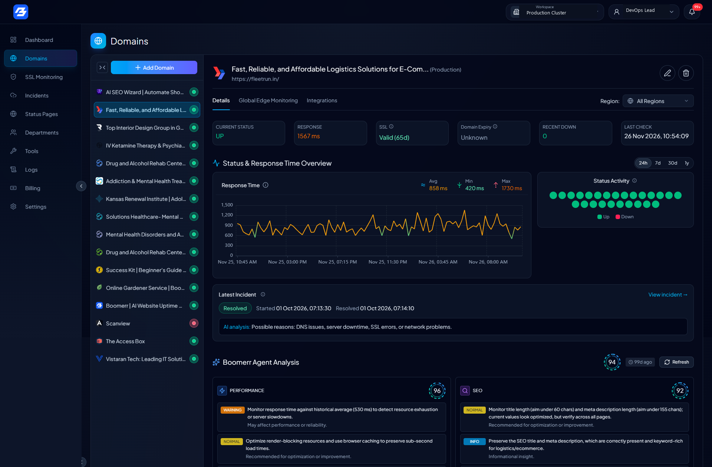
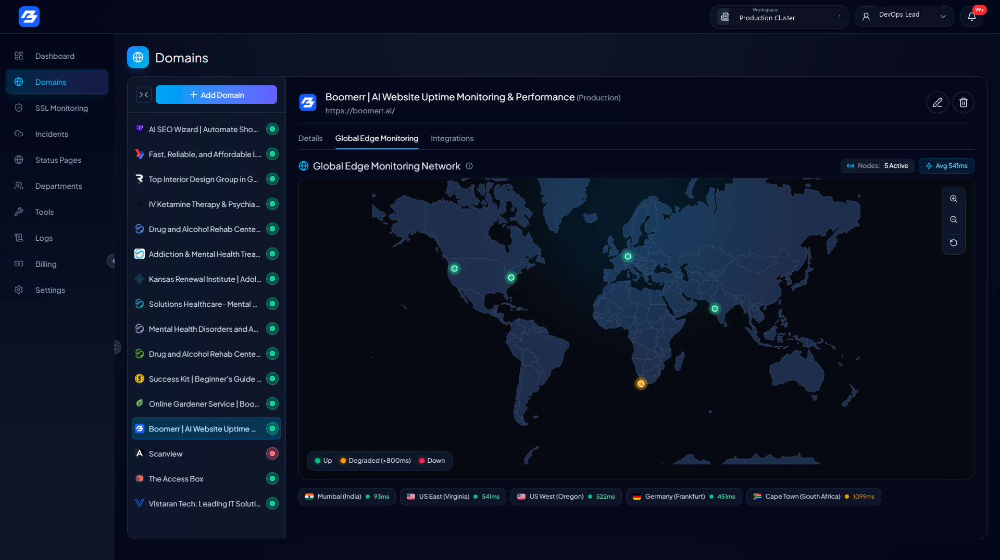
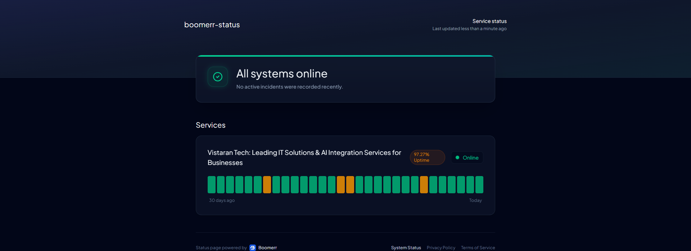

<p align="center">
  
</p>

<h1 align="center">Boomerr</h1>

<p align="center">
  <strong>Self-hosted website and domain monitoring with automated ad spend protection, incident diagnostics, and public status pages.</strong>
</p>

<p align="center">
  <a href="https://github.com/vistaran/boomerr/actions/workflows/ci.yml"></a>
  <a href="https://discord.gg/Sw5rrQ26MP"></a>
  
  
  
  
  
</p>

---

## ⚡ Overview

Boomerr is an open-source, self-hosted platform for uptime monitoring, SSL certificate tracking, incident diagnosis, and status page hosting. Built for developers, site reliability engineers, and marketing teams, Boomerr also includes native ad spend protection: when an outage is detected, active Google Ads and Meta Ads campaigns are automatically paused to prevent wasted ad budget, then resumed once the endpoint recovers.

Self-hosted deployments run without artificial endpoint limits, paywalls, or external tracking telemetry.

---

## 📸 Product Tour

<div align="center">

### 📊 Operations Dashboard
*Real-time visibility across monitored endpoints, response latency sparklines, SSL certificate status, and 30-day uptime metrics.*
<br/>


<br/><br/>

### 🔍 Domain Health & Root-Cause Diagnostics
*Sub-second latency records, automated incident triage, and integrated audits for performance, SEO, and user experience.*
<br/>


<br/><br/>

### 🌍 Multi-Region Edge Monitoring
*Distributed probe architecture measuring uptime and latency across global regions including North America, Europe, Asia, and Africa.*
<br/>


<br/><br/>

### 🛡️ Automated Ad Spend Protection
*Synchronize connected Google Ads and Meta Ads accounts to pause active campaigns during downtime and resume them upon recovery.*
<br/>


<br/><br/>

### 📢 Public Status Pages
*Branded status pages with custom domains, real-time incident updates, 30-day uptime bars, and subscriber notifications.*
<br/>


</div>

---

## ⚖️ Why Boomerr?

| Capability | Boomerr (Community) | Uptime Kuma | Better Stack | Pingdom |
|---|:---:|:---:|:---:|:---:|
| **License & Hosting** | Open Source (AGPL-3.0) | Open Source (MIT) | Proprietary / Cloud | Proprietary / Cloud |
| **Ad Spend Protection** | Native (Google & Meta) | Not supported | Not supported | Not supported |
| **Outage Root-Cause Triage** | Built-in (LLM + Heuristics) | Not supported | Cloud Addon | Not supported |
| **Multi-Region Edge Probes** | Included (Docker & Lambda) | Custom relay setup | Included (Cloud) | Included (Cloud) |
| **Real-Time Updates** | WebSockets (Laravel Reverb) | WebSockets (Socket.io) | WebSockets (Cloud) | Polling |
| **Workspaces & RBAC** | Multi-workspace RBAC | Single-tenant | Paid tiers | Paid tiers |
| **Performance & SEO Audits** | Built-in synthetic audits | Not supported | Not supported | Synthetic only |
| **SSL Handshake Tracking** | Direct X.509 socket probe | Basic expiration check | Included (Cloud) | Included (Cloud) |
| **Pricing** | Free (Self-Hosted) | Free (Self-Hosted) | Commercial ($29+/mo) | Commercial ($10+/mo) |

---

## ✨ Features

### 🌐 Uptime & Certificate Monitoring
- **High-Frequency Health Checks:** Configurable HTTP/HTTPS probes with sub-minute intervals, response time tracking, and HTTP status code validation.
- **SSL/TLS Certificate Tracking:** Native socket X.509 handshake inspection with automated warning alerts at 30, 14, and 3 days before expiration.
- **Distributed Edge Probes:** Support for containerized (Docker) and serverless (AWS Lambda) probe nodes to verify latency and availability across multiple geographic regions.
- **Live Event Streaming:** Real-time dashboard updates powered by Laravel Reverb without third-party messaging services.

### 🛡️ Ad Spend Protection
- **Automated Campaign Guard:** Direct integration with Google Ads and Meta (Facebook) Ads APIs.
- **Budget Preservation:** Immediately pauses active campaigns when a landing page fails health checks, preventing wasted ad spend during downtime.
- **Automatic Recovery:** Resumes paused campaigns automatically once verified consecutive successful checks are recorded.

### 🤖 Incident Management & Auditing
- **Automated Root-Cause Triage:** Diagnostic analysis supporting local LLMs (Ollama) or hosted models (DeepSeek, OpenAI) alongside deterministic heuristic checks.
- **Performance & SEO Audits:** Heuristic evaluation of response payloads, meta headers, Core Web Vitals indicators, and SSL configurations.
- **Diagnostic Network Utilities:** Public diagnostic endpoints for DNS lookups, global DNS propagation verification, SSL chain inspection, and platform detection.

### 📢 Notifications & Status Pages
- **Multi-Channel Alerting:** Dispatch incident notifications via SMTP email, Discord, Telegram, Slack, SMS (Twilio/MSG91), and WhatsApp.
- **Customizable Status Pages:** Host public or private status pages on custom domains with historical uptime records and incident communications.
- **Subscriber Notifications:** Allow end-users to subscribe to status page incident feeds via email.

### 🔒 Security & Multi-Tenancy
- **Workspaces & RBAC:** Organization-level data isolation with granular role assignments (Owner, Admin, Member).
- **SSRF Prevention:** Private IP blocking and DNS rebinding protections for all user-submitted target endpoints.
- **Container Architecture:** Production-ready multi-container configuration orchestrated via Docker Compose.

---

## 🚀 Quickstart

### Prerequisites
- Docker Engine 24.0+
- Docker Compose v2.20+

### 1. Clone the Repository
```bash
git clone https://github.com/vistaran/boomerr.git
cd boomerr
```

### 2. Run the Setup Script
```bash
chmod +x setup.sh
./setup.sh
```

The setup script checks prerequisites, generates application keys, writes `.env`, initializes containers, runs database migrations, and prompts to create the initial administrator account.

### 3. Access the Dashboard
Open `http://localhost:8080` in your browser and sign in with the administrator credentials configured during setup.

---

## 🛠️ Management CLI

Boomerr includes built-in Artisan commands for administrative workflows:

| Task | Command |
|---|---|
| System health diagnostic | `docker compose exec api php artisan boomerr:doctor` |
| Create administrator | `docker compose exec api php artisan boomerr:admin:create` |
| Stream container logs | `docker compose logs -f` |
| Run pending migrations | `docker compose exec api php artisan migrate --force` |
| Clear application cache | `docker compose exec api php artisan config:clear && docker compose exec api php artisan route:clear` |

---

## 📦 Architecture

```
                    [ Port 8080 (HTTP) ]
                             │
                             ▼
                    ┌─────────────────┐
                    │  web (Nginx)    │
                    └───┬─────────┬───┘
                        │         │
             /api/*     ▼         ▼     /app/* (WebSockets)
        ┌─────────────────┐     ┌──────────────────┐
        │  api (PHP-FPM)  │     │ reverb (Sockets) │
        └───────┬─────────┘     └────────┬─────────┘
                │                        │
       ┌────────┴────────┐               │
       │ worker / sched. │               │
       └────────┬────────┘               │
                ├────────────────────────┤
                ▼                        ▼
        ┌─────────────────┐     ┌──────────────────┐
        │ db (MariaDB 11) │     │ redis (Redis 7)  │
        └─────────────────┘     └──────────────────┘
```

---

## 📚 Documentation

Detailed setup guides and reference manuals:

- [Ads Protection Guide (Google & Meta Ads)](docs/ads-protection-guide.md)
- [Edge Monitoring Probes Guide](docs/edge-monitoring-guide.md)
- [Docker Deployment & Production SSL Guide](docs/docker-deployment.md)
- [Configuration Reference (.env)](docs/configuration-reference.md)
- [Troubleshooting & FAQ](docs/troubleshooting.md)
- [Backup & Disaster Recovery](docs/backup-restore.md)

---

## 🤝 Contributing

Contributions, bug reports, and pull requests are welcome. Please ensure new features or bug fixes include corresponding unit or integration tests. Review [CONTRIBUTING.md](CONTRIBUTING.md) for contribution guidelines.

---

## 💬 Community

- **Discord:** Join the [Boomerr Discord Community](https://discord.gg/Sw5rrQ26MP) for technical discussion, release previews, and troubleshooting.
- **GitHub Discussions:** Propose features or ask architectural questions in [Discussions](https://github.com/vistaran/boomerr/discussions).
- **Issue Tracker:** Report verified defects or feature requests on [Issues](https://github.com/vistaran/boomerr/issues).

---

## ⭐ Star History

[](https://star-history.com/#vistaran/boomerr&Date)

---

## 📄 License

Boomerr is open-source software licensed under the **GNU Affero General Public License v3.0 (AGPL-3.0)**.
