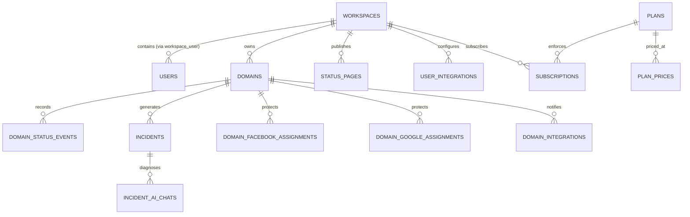

# Current Architecture & Component Relationships

## 1. Executive Architecture Overview

**Boomerr** is a full-stack, multi-tenant website, SSL, domain expiration, and digital advertising uptime monitoring platform. Originally designed as a commercial SaaS solution, the system consists of a Laravel 12 backend API with real-time WebSocket broadcasting (via Laravel Reverb), a React 19 single-page application (SPA) built with Vite and Tailwind CSS, background worker queues, and scheduled telemetry cron jobs.

```mermaid
flowchart TB
    subgraph ClientLayer ["Client Layer"]
        Browser["React 19 SPA (Dashboard / Admin / Status Pages)"]
    end

    subgraph IngressLayer ["Ingress & Web Layer"]
        Nginx["Web Server / Reverse Proxy"]
        LaravelWeb["Laravel HTTP Kernel (PHP 8.2+)"]
    end

    subgraph CoreApplication ["Boomerr Application Core"]
        AuthMiddleware["Sanctum Auth & Workspace Tenancy Middleware"]
        Controllers["REST & Public Tools Controllers"]
        Services["DomainHealth, Billing, Ads, AI Services"]
    end

    subgraph RealTimeLayer ["Real-Time & Event Layer"]
        Reverb["Laravel Reverb (WebSocket Server :8080)"]
        Echo["Laravel Echo Client (Pusher Protocol)"]
    end

    subgraph AsyncWorkerLayer ["Async & Scheduled Tasks"]
        Cron["Laravel Scheduler (schedule:run)"]
        QueueWorkers["Queue Workers (monitoring, notifications, system-logs, default)"]
    end

    subgraph DataStorage ["Data & Cache Storage"]
        DB[(Relational DB: SQLite / MySQL)]
        Redis[(Redis: Cache, Queue, Reverb State)]
        LocalFiles["Local Filesystem / S3 Storage"]
    end

    subgraph ExternalEcosystem ["External Services & Probes"]
        TargetSites["Monitored Targets (HTTP/HTTPS/SSL/DNS)"]
        LambdaGrid["AWS Lambda Multi-Region Grid (Optional SaaS)"]
        AIProviders["DeepSeek / OpenAI / Gemini APIs"]
        AdsAPIs["Meta Marketing API & Google Ads API"]
        AlertGateways["Slack, Discord, Telegram, Twilio, MSG91"]
    end

    Browser <-->|HTTP / REST API| Nginx
    Browser <-->|WebSockets (Channels)| Reverb
    Nginx --> LaravelWeb
    LaravelWeb --> AuthMiddleware
    AuthMiddleware --> Controllers
    Controllers --> Services
    Services --> DB
    Services --> Redis
    Services --> LocalFiles

    Cron -->|Dispatch Checks Every Minute| QueueWorkers
    QueueWorkers --> Services
    Services -->|Execute HTTP / Socket Checks| TargetSites
    Services -->|Invoke Async Checks (SaaS Mode)| LambdaGrid
    LambdaGrid -->|Post Results /api/monitoring/results| Controllers
    Services -->|Broadcast DomainStatusUpdated| Reverb
    Reverb -.-> Echo
    Echo -.-> Browser

    Services -->|Generate Diagnostics| AIProviders
    Services -->|Auto-Pause / Resume on Outage| AdsAPIs
    Services -->|Send Alerts on Down/Up| AlertGateways
```

---

## 2. Component Breakdown & Relationships

### 2.1 Backend Application (`backend/`)
- **Framework:** Laravel 12 (`laravel/framework: ^12.0`) running on PHP 8.2+.
- **Authentication & Security:** Laravel Sanctum (`laravel/sanctum: ^4.0`) issuing Bearer API tokens for authenticated users and administrators. Security headers, rate limiting (`RateLimitMiddleware`), and IP blocking (`CheckIpBlockList`) are applied globally.
- **Multi-Tenancy Model:** Workspaces (`workspaces` table) act as the primary tenant boundary. Users belong to workspaces through the `workspace_user` pivot table with explicit roles (`owner`, `admin`, `member`). Company-scoped requests pass `X-Company-ID: <workspace_id>` or resolve the active workspace via `EnsureWorkspaceAccess` / `EnsureUserCanManageCompanyResources` middleware.
- **Routing Surface:**
  - `routes/api.php`: Core application REST endpoints (domains, status stats, SSL, notifications, integrations, tools, developer webhooks, public tools).
  - `routes/admin.php`: Administrative management API (users, admins, platform health, billing overrides, email sequence automation, announcements).
  - `routes/channels.php`: Broadcast channel authorization for real-time WebSocket feeds (`company.{id}`, `workspace.{id}`, `admin`).
  - `routes/console.php`: Cron scheduler definitions executing recurring uptime, SSL, WHOIS, log pruning, and lifecycle jobs.
  - `routes/web.php`: Single-page app fallback routing and OAuth callbacks (Shopify, GitHub, Facebook, Google).

### 2.2 Frontend Application (`frontend/`)
- **Framework:** React 19 (`react: ^19.2.0`, `react-dom: ^19.2.0`) bundled with Vite 7 (`vite: ^7.2.4`) and TypeScript (`typescript: ~5.9.3`).
- **Styling & UI:** Tailwind CSS v4 (`@tailwindcss/vite: ^4.1.17`, `tailwindcss: ^4.1.17`), Lucide React icons (`lucide-react`), Framer Motion (`framer-motion`), and ECharts / Recharts for latency and uptime visualization.
- **State Management & Data Fetching:** TanStack React Query (`@tanstack/react-query: ^5.90.12`) with centralized query keys and custom hooks.
- **Real-Time Subscription:** `laravel-echo` paired with `pusher-js` configured to connect to Laravel Reverb. Subscribes to private workspace channels to update the UI cache without page reloads.

### 2.3 Real-Time WebSocket Infrastructure (Laravel Reverb)
- **Engine:** `laravel/reverb: ^1.6` running as a dedicated daemon process (`php artisan reverb:start`).
- **Protocol:** Pusher WebSocket protocol emulation over port 8080 (or 443 via reverse proxy).
- **Events Broadcasted:**
  - `DomainStatusUpdated`: Triggered when an uptime check switches state (e.g. up to down, down to up) or updates latency.
  - `DomainCreated`, `DomainUpdated`, `DomainDeleted`: Instant monitor synchronization.
  - `WebhookCreated`, `WebhookUpdated`, `WebhookDeleted`: Developer webhook event state changes.
  - `TeamMemberAdded`, `TeamMemberUpdated`, `TeamMemberRemoved`: Real-time workspace permission sync.

### 2.4 Monitoring Workers & Execution Engine
Boomerr features a dual-mode monitoring architecture:

1. **Native Local Monitoring Engine (Fully Self-Hostable):**
   - Scheduled by `php artisan monitor:run-uptime-checks` every minute.
   - Evaluates active domains whose `next_check_at` timestamp is due.
   - Dispatches `App\Jobs\ProcessUptimeCheckJob` to the `monitoring` queue with deduplication locks (`Cache::lock`).
   - Uses `App\Services\DomainHealthService` executing direct HTTP requests using Laravel's HTTP Client (`GuzzleHttp`). Measures latency (ms), HTTP response codes, headers, and failure reasons.
   - If a domain fails, schedules `App\Jobs\ProcessUptimeConfirmationJob` to re-verify the failure before declaring an incident, preventing false positives.

2. **AWS Lambda Multi-Region Grid (Proprietary SaaS Mode):**
   - Scheduled by `php artisan monitor:run-lambda-checks`.
   - Enabled when `MONITORING_LAMBDA_ENABLED=true` and `MonitoringRegion` records are configured.
   - Uses `App\Services\MonitoringDispatcherService` to invoke serverless AWS Lambda functions asynchronously across multiple AWS regions (`ap-south-1`, `us-east-1`, `us-west-2`, `eu-central-1`, etc.).
   - Lambda probes test targets from diverse geographic locations and post results back to `POST /api/monitoring/results` using `MONITORING_API_KEY` authentication.

3. **SSL Certificate Monitoring Engine:**
   - Scheduled by `php artisan monitor:run-ssl-checks` every minute.
   - Evaluates active domains without recent SSL checks or expiring within 3 days.
   - Connects directly to host port 443 using PHP stream sockets (`stream_context_create(['ssl' => ['capture_peer_cert' => true]])`).
   - Extracts issuer, valid-from, valid-to, calculates remaining days, and triggers alerts if certificates are invalid or near expiration. Zero external API dependencies.

4. **WHOIS & Domain Expiration Monitoring:**
   - Scheduled by `php artisan monitor:run-whois-checks` daily.
   - Uses `io-developer/php-whois` to execute direct WHOIS protocol queries against TLD root servers. Tracks domain registration expiration dates without paid third-party APIs.

### 2.5 AI Diagnostics Engine
- **Service:** `App\Services\AI\IncidentAIService` and `App\Services\AI\DomainAnalysisService`.
- **Model Integration:** OpenAI PHP SDK (`openai-php/laravel: ^0.18.0`) configured with DeepSeek (`https://api.deepseek.com/v1`, model `deepseek-chat`) or Google Gemini (`google_genai`).
- **Functionality:**
  - Auto-analyzes outages on incident creation by packaging HTTP status code, response headers (filtered by `BOOMERR_AI_HEADER_FILTER`), response body snippet, and exception message.
  - Produces root-cause hypotheses (e.g. DNS misconfiguration, SSL handshake timeout, Cloudflare 521 Origin Down).
  - Offers an interactive incident chat (`/api/incidents/{id}/chat` and `/api/incidents/{id}/chat-stream`).
  - Provides synthetic scores (Performance, SEO, UX) and optimization tips for added domains.

### 2.6 Ads Protection Engine (Ad-Spend Shield)
- **Services:** `GoogleAdsService`, `GoogleAdsAssignmentService`, `FacebookAdsAssignmentService`.
- **Listeners:** `HandleDomainStatusForFacebookAds` and `HandleDomainStatusForGoogleAds` attached to `DomainStatusUpdated`.
- **Mechanism:**
  - Users authenticate their Meta (Facebook) Ads or Google Ads accounts via OAuth.
  - Specific campaigns or ads are mapped to monitored domains.
  - When Boomerr detects a target domain transition to `down`, the listener executes queued API calls to pause the assigned ads or campaigns, stopping ad spend during downtime.
  - When the domain recovers to `up`, Boomerr resumes only the ads that were automatically paused by the system.

### 2.7 Alerting & Notification Pipeline
- **Channel Dispatcher:** `App\Services\DomainChangeNotifier` and queued jobs (`SendWhatsAppAlertJob`, `SendSmsAlertJob`, `DispatchWebhookJob`).
- **Supported Channels:**
  - Email (SMTP / SES / Postmark / Resend)
  - Slack (Incoming Webhooks)
  - Discord (Incoming Webhooks)
  - Telegram (Telegram Bot API webhook & bot commands)
  - WhatsApp (Meta WhatsApp Cloud API & Twilio WhatsApp)
  - SMS & Voice (MSG91, Twilio, Plivo)
  - Custom Developer Webhooks (HMAC-SHA256 signature verification, retry policies, delivery audit logs).

---

## 3. Data Storage & Schema Relationships



- **`workspaces`**: Core tenant table holding slug, primary contact, timezone, and billing plan bindings.
- **`users`**: User profiles with credentials, Google OAuth sub, marketing flags, and security controls.
- **`workspace_user`**: Pivot assigning roles (`owner`, `admin`, `member`) and default active workspace.
- **`domains`**: Monitored targets storing URL, name, status (`up`/`down`), check intervals, SSL expiry, WHOIS expiry, and last response metrics.
- **`domain_status_events`**: High-frequency time-series table logging individual ping outcomes, response latencies, HTTP status, and region.
- **`incidents`**: Aggregated downtime records containing duration, HTTP errors, response body snapshots, Browsershot S3 screenshot keys, and AI summaries.
- **`incident_ai_chats`**: Threaded conversational history for LLM root-cause troubleshooting.
- **`domain_facebook_assignments` & `domain_google_assignments`**: Mapping domains to remote ad accounts and campaign IDs for outage pausing.
- **`notification_channels` & `integrations`**: Alert endpoints (Slack, Discord, Telegram, Webhook URLs).
- **`subscriptions`, `plans`, `plan_prices`**: Commercial billing state, Razorpay customer IDs, subscription status, and invoice tracking.

---

## 4. Current Deployment & Execution Model

In its current state, Boomerr runs across disconnected local or server environments:
1. **API Server:** Executed via `php artisan serve` or Nginx/Apache pointing to `backend/public/`.
2. **Workers:** Executed via `php artisan queue:listen` or `queue:work`.
3. **Scheduler:** Requires system `cron` invoking `* * * * * cd /path/to/backend && php artisan schedule:run >> /dev/null 2>&1`.
4. **WebSockets:** Requires dedicated supervisor process running `php artisan reverb:start`.
5. **Frontend:** Built via Vite (`npm run build`) or served via Vite dev server (`npm run dev` on port 5173).
6. **Database:** SQLite or MySQL running locally or via cloud DB.

**Key Migration Insight:** The system contains everything required for self-hosted operation, but lacks containerization, uniform process supervision, and decoupled billing defaults.
