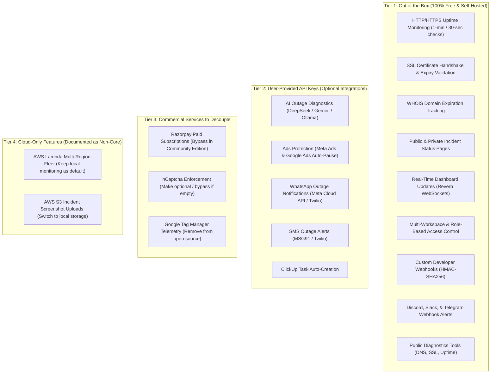

# External Dependencies & Self-Hosting Matrix

## 1. Complete Dependency Matrix

The table below documents every third-party service, API, and integration in Boomerr. It details how each service is currently used, whether it is required for core functionality, its self-hosted alternative, and its pricing model.

| Dependency / Service | Current Usage in Boomerr | Required for Core? | Self-Hosted Alternative | Free / Paid | Category |
|---|---|---|---|---|---|
| **PHP HTTP Client (Guzzle)** | Native local uptime checking, latency measurement, status codes | **YES** | Built-in standard library / native socket checks | **Free / Self-Hosted** | Out of the Box |
| **PHP Stream Sockets** | Direct port 443 SSL certificate expiration & issuer validation | **YES** | Native OpenSSL / Stream sockets in PHP core | **Free / Self-Hosted** | Out of the Box |
| **io-developer/php-whois** | Direct socket queries to TLD WHOIS servers for domain expiry | **YES** | Native socket-based WHOIS protocol | **Free / Self-Hosted** | Out of the Box |
| **Laravel Reverb** | Real-time WebSocket broadcasting to React dashboard | **YES** | Native included Laravel Reverb server daemon | **Free / Self-Hosted** | Out of the Box |
| **SMTP / Mailgun / SES** | Alert emails, user verification, team invitations, OTP | No (Optional) | Any standard SMTP (Postfix, Mailcow, Sendgrid, Mailpit) | Free tier available / Paid | Configurable API |
| **Discord Webhooks** | Outage and recovery alerts to workspace Discord channels | No (Optional) | Discord Incoming Webhook (native HTTPS POST) | **Free** | Configurable API |
| **Slack Webhooks** | Outage alerts posted to workspace Slack channels | No (Optional) | Slack Incoming Webhook (native HTTPS POST) | **Free** | Configurable API |
| **Telegram Bot API** | Outage alerts to Telegram chats/groups via bot webhook | No (Optional) | Telegram Bot API (via BotFather token) | **Free** | Configurable API |
| **Developer Webhooks** | Custom JSON HTTP POST delivery to user endpoints with HMAC-SHA256 | No (Optional) | Built-in job (`DispatchWebhookJob`) | **Free / Self-Hosted** | Out of the Box |
| **DeepSeek API** | Outage diagnostics, root-cause analysis, and incident chat | No (Optional) | Local Ollama / vLLM (OpenAI-compatible) or disable AI | Pay-as-you-go (~$0.14/M tokens) | User API Credential |
| **Google Gemini (GenAI)** | Alternative AI model for outage and domain health scoring | No (Optional) | Disable or use DeepSeek / Ollama | Free tier available | User API Credential |
| **AWS Lambda** | Multi-region probe execution across multiple AWS regions | **NO** | Native local worker (`RunUptimeChecks`) | Paid (Serverless compute) | Proprietary SaaS |
| **Meta (Facebook) Ads** | Auto-pausing & resuming Facebook campaigns during outage | No (Optional) | None (Requires Meta Graph API) | Free API (Requires Ad Spend) | User API Credential |
| **Google Ads API** | Auto-pausing & resuming Google Ads campaigns during outage | No (Optional) | None (Requires Google Ads API developer token) | Free API (Requires Developer Token) | User API Credential |
| **Meta WhatsApp Cloud** | Real-time outage alerts sent to user WhatsApp numbers | No (Optional) | Evolution API / Baileys (self-hosted WhatsApp bridge) | Free (First 1,000 msgs/mo) | User API Credential |
| **Twilio (SMS / WA)** | Outage alerts and OTP codes via SMS or WhatsApp | No (Optional) | Any generic HTTP SMS gateway or disable SMS | Pay-as-you-go | User API Credential |
| **MSG91** | OTP and outage SMS delivery in India | No (Optional) | Standard SMTP / Email or Twilio | Pay-as-you-go | User API Credential |
| **Plivo** | Voice phone calls alerting users of critical down state | No (Optional) | Asterisk / FreePBX or disable phone calls | Pay-as-you-go | User API Credential |
| **ClickUp API** | Auto-creating and resolving incident tasks in ClickUp | No (Optional) | GitLab / GitHub Issues or native developer webhook | Free tier available | User API Credential |
| **Razorpay** | Subscription billing, credit purchases, plan upgrades | **NO** | Remove / disable for self-hosted community edition | Paid (Transaction fees) | Commercial Only |
| **hCaptcha** | Anti-bot challenge on registration and login | **NO** | Built-in Laravel rate limiting (`RateLimitMiddleware`) | Free tier | Optional / Remove |
| **Google Tag Manager** | SaaS visitor tracking (`G-YDE08CL8FW`) | **NO** | Self-hosted Umami / Plausible or completely remove | Free | Commercial Only |
| **Spatie Browsershot** | Automated Chromium screenshot of outages and PDF reports | No (Optional) | Headless Chrome container or disable screenshots | **Free / Open Source** | Host Dependency |

---

## 2. Feature Classification Breakdown

To establish true open-source self-hostability, features are categorized into four distinct operating tiers:



---

## 3. Deep-Dive on Core Systems

### 3.1 Website, SSL & WHOIS Monitoring (Works 100% Out of the Box)
- **Codebase Confirmation:** In `App\Services\DomainHealthService`, `runUptimeCheck()` uses Laravel's built-in `Http::timeout()->retry()->get()`. It calculates precise response time in milliseconds, captures HTTP headers, and handles redirection.
- **SSL Verification:** In `DomainHealthService::runSslCheck()`, the application establishes a direct PHP stream socket on port 443 with `stream_context_create(['ssl' => ['capture_peer_cert' => true]])`. It reads the X.509 certificate and calculates days remaining natively.
- **WHOIS Tracking:** In `WhoisService.php`, the library `io-developer/php-whois` connects over socket port 43 to official registrar WHOIS servers.
- **Self-Hosting Verdict:** **Fully functional out of the box.** No paid APIs, external SaaS accounts, or proxies are required for complete monitoring.

### 3.2 AI Diagnostics Integration (User-Provided API Key)
- **Current Mechanism:** `IncidentAIService` connects to `https://api.deepseek.com/v1` using `DEEPSEEK_API_KEY`. It passes filtered incident context (HTTP status, error message, response snippet) and returns actionable recovery steps.
- **Self-Hosting Strategy:**
  1. Default: Disabled if `DEEPSEEK_API_KEY` is omitted. The UI cleanly hides or marks the AI summary as "AI diagnostics not configured".
  2. Cloud LLM: Users can input their own DeepSeek or OpenAI API key.
  3. Local LLM: Because DeepSeek uses standard OpenAI chat completions format, users can point `DEEPSEEK_ENDPOINT` (or a new `AI_ENDPOINT` variable) to a local **Ollama** or **vLLM** container (`http://ollama:11434/v1`).

### 3.3 Ads Protection (User-Provided API Key)
- **Current Mechanism:** Users authenticate through OAuth. When a domain goes down, `HandleDomainStatusForGoogleAds` and `HandleDomainStatusForFacebookAds` pause the connected campaigns. When the domain recovers, they resume them.
- **Self-Hosting Strategy:**
  - This feature is completely optional. If a self-hoster does not provide Meta or Google Ads credentials, the listeners gracefully skip execution (`shouldQueue` checks `domain->facebookAssignments()->exists()`).
  - Self-hosters who manage ads can provide their own OAuth App Client ID and Secret to use this feature for free.

### 3.4 Email, WhatsApp, and SMS Notifications
- **Email:** Can be routed to any standard free SMTP server (e.g. Gmail SMTP, local Postfix container, or testing via Mailpit).
- **Discord & Slack:** Completely free and supported out of the box via incoming webhook URLs.
- **Telegram:** Completely free using Telegram's official BotFather API.
- **WhatsApp & SMS:** Requires user-provided accounts (Meta Cloud API, Twilio, MSG91). If unconfigured, the system restricts alerts to email and chat webhooks.

### 3.5 AWS Lambda Multi-Region Monitoring
- **Current Code:** `RunLambdaUptimeChecks.php` invokes AWS Lambda functions asynchronously across multiple AWS regions.
- **Reality in Codebase:** The codebase already contains a check in `RunUptimeChecks.php`:
  ```php
  $isLambdaEnabled = (bool) config('monitoring.lambda_enabled', false) && !app()->environment('local', 'testing');
  $hasActiveRegions = $isLambdaEnabled && MonitoringRegion::where('is_active', true)->exists();
  ```
  If `$hasActiveRegions` is false, `RunUptimeChecks` **monitors all domains locally using the local queue worker**.
- **Self-Hosting Verdict:** AWS Lambda is **not required**. The local monitoring engine handles 100% of checks. For advanced users wanting multi-region checks in the future, a lightweight open-source agent or probe container can replace Lambda.

### 3.6 Incident Screenshots (Browsershot / Puppeteer)
- **Current Code:** `IncidentRecorderService::captureScreenshotToS3` uses Browsershot to take a screenshot and then uploads it directly to an AWS S3 client with a hardcoded region (`ap-south-1`).
- **Self-Hosting Strategy:**
  - Refactor to store screenshots on the configured Laravel filesystem (`Storage::disk(config('filesystems.default'))`). When `FILESYSTEM_DISK=local`, screenshots are saved in `storage/app/public/screenshots/` and served via Nginx.
  - Make Browsershot failure non-fatal (log warning and proceed without screenshot if Node/Chromium is absent).
