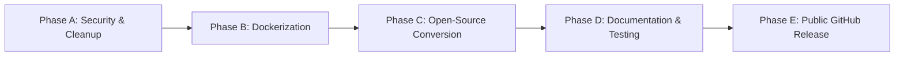

# Step-by-Step Implementation Roadmap

## 1. Roadmap Overview & Timeline

The open-source migration is organized into five sequential phases:

---

## 2. Phase A — Security & Code Cleanup

### Task A.1: Fix SSRF in Public Tools & Monitoring
- **Priority:** **Critical**
- **Estimated Effort:** 6 hours
- **Dependencies:** None
- **Files Modified:**
  - `backend/app/Helpers/SecurityHelper.php` (New)
  - `backend/app/Http/Controllers/Tools/UptimeCheckerController.php`
  - `backend/app/Http/Controllers/Tools/AdLandingPageCheckerController.php`
  - `backend/app/Http/Controllers/Tools/ShopifyDetectorController.php`
  - `backend/app/Services/DomainHealthService.php`
- **Risks:** Valid domains with unusual DNS records or intranet setups might be blocked if validation is too rigid.
- **Acceptance Criteria:** Any attempt to check `http://169.254.169.254`, `http://127.0.0.1`, `http://localhost`, `http://10.x.x.x`, or `http://192.168.x.x` is immediately rejected with HTTP 422 "Access to private or reserved IP ranges is prohibited".

### Task A.2: Remove Discord Exception Reporting & Debug Routes
- **Priority:** **Critical**
- **Estimated Effort:** 2 hours
- **Dependencies:** None
- **Files Modified:**
  - `backend/bootstrap/app.php`
  - `backend/routes/api.php`
- **Risks:** Minimal.
- **Acceptance Criteria:** Unhandled exceptions are logged to standard Laravel channels without transmitting data to remote webhooks. Endpoints `/_debug/log-test` and `/_debug/sms-test` return HTTP 404.

### Task A.3: Make hCaptcha Optional on Authentication
- **Priority:** **High**
- **Estimated Effort:** 3 hours
- **Dependencies:** None
- **Files Modified:**
  - `backend/app/Http/Controllers/Auth/AuthController.php`
  - `backend/app/Http/Controllers/Admin/AuthController.php`
  - `frontend/src/components/auth/auth-card.tsx`
  - `frontend/src/pages/admin/Login.tsx`
- **Risks:** Increased exposure to automated bot spam if self-hosters expose instances without rate limiting.
- **Acceptance Criteria:** When `HCAPTCHA_SITE_KEY` and `HCAPTCHA_SECRET_KEY` are empty in `.env`, login, registration, and password reset proceed normally without rendering captcha or demanding captcha tokens.

### Task A.4: Refactor Incident Screenshot Storage to Local Disk
- **Priority:** **High**
- **Estimated Effort:** 4 hours
- **Dependencies:** None
- **Files Modified:**
  - `backend/app/Services/IncidentRecorderService.php`
  - `backend/app/Http/Controllers/IncidentController.php`
- **Risks:** Node.js/Chromium must be present on the host or container for screenshots to be generated.
- **Acceptance Criteria:** Screenshots are saved via `Storage::disk(config('filesystems.default'))`. When AWS credentials are absent, the application stores screenshots locally in `storage/app/public/screenshots/` and serves them without throwing unhandled exceptions.

### Task A.5: Repository Cleanup of Ad-Hoc Scripts
- **Priority:** **Medium**
- **Estimated Effort:** 1 hour
- **Dependencies:** None
- **Files Deleted:**
  - `repair_db.php`, `index.html` (root)
  - `backend/check_deliveries.php`, `backend/check_deliveries2.php`, `backend/check_events.php`
  - `backend/check_payloads.php`, `backend/dummy.php`, `backend/list_jobs.php`
  - `backend/scaffold_job.php`, `backend/scaffold_mailables.php`, `backend/scaffold_views.php`
  - `backend/test_update.php`, `backend/.phpunit.result.cache`
  - `frontend/test-streaming.html`
- **Risks:** None.
- **Acceptance Criteria:** Repository root and backend directory contain only clean application files.

---

## 3. Phase B — Dockerization & Containerization

### Task B.1: Create Multi-Stage Dockerfile & Entrypoint Script
- **Priority:** **Critical**
- **Estimated Effort:** 8 hours
- **Dependencies:** Phase A
- **Files Modified:**
  - `docker/Dockerfile` (New)
  - `docker/entrypoint.sh` (New)
  - `docker/php/php.ini`, `docker/php/opcache.ini` (New)
- **Risks:** Extension compilation issues on Alpine Linux; file permission problems with www-data.
- **Acceptance Criteria:** Image builds successfully; entrypoint script runs migrations and handles startup checks.

### Task B.2: Create Docker Compose & Nginx Configuration
- **Priority:** **Critical**
- **Estimated Effort:** 6 hours
- **Dependencies:** Task B.1
- **Files Modified:**
  - `docker-compose.yml` (New)
  - `docker/nginx/default.conf` (New)
  - `.env.example` (Root)
- **Risks:** WebSocket proxy misconfiguration causing Reverb connection drops.
- **Acceptance Criteria:** `docker compose up -d` boots all 7 containers (web, api, worker, scheduler, reverb, db, redis) into a healthy state. WebSockets connect cleanly through Nginx on port 80/443.

### Task B.3: Implement First-Time Admin Setup Command
- **Priority:** **High**
- **Estimated Effort:** 4 hours
- **Dependencies:** Task B.1
- **Files Modified:**
  - `backend/app/Console/Commands/CreateAdminUserCommand.php` (New)
- **Risks:** None.
- **Acceptance Criteria:** Running `docker compose exec api php artisan boomerr:admin:create` prompts for admin name, email, and password, and creates an active admin record.

---

## 4. Phase C — Open-Source Conversion & Billing Decoupling

### Task C.1: Implement Community Edition / Billing Bypass Switch
- **Priority:** **Critical**
- **Estimated Effort:** 8 hours
- **Dependencies:** Phase B
- **Files Modified:**
  - `backend/config/billing.php`
  - `backend/app/Services/PlanLimitService.php`
  - `backend/app/Http/Controllers/DomainController.php`
  - `backend/app/Http/Controllers/StatusPageController.php`
  - `backend/app/Http/Controllers/TeamMemberController.php`
- **Risks:** Edge case where a workspace is still treated as "free" with restrictions.
- **Acceptance Criteria:** When `ENABLE_BILLING=false`, all workspaces have unlimited domains, 1-minute monitoring frequency, SSL monitoring enabled, AI diagnostics enabled, and unlimited status pages.

### Task C.2: Remove Commercial SaaS Telemetry & Branding
- **Priority:** **High**
- **Estimated Effort:** 4 hours
- **Dependencies:** None
- **Files Modified:**
  - `frontend/index.html` (Remove GTM tag `G-YDE08CL8FW`)
  - `frontend/src/reverb-echo.ts` (Remove fallback `https://api.boomerr.ai`)
  - `frontend/src/pages/billing-page.tsx` (Conditionally hide or display Community Edition status)
- **Risks:** None.
- **Acceptance Criteria:** No network calls to `boomerr.ai` or Google Tag Manager occur when navigating the frontend.

### Task C.3: Make AI Diagnostics Provider Configurable
- **Priority:** **Medium**
- **Estimated Effort:** 4 hours
- **Dependencies:** None
- **Files Modified:**
  - `backend/app/Services/AI/IncidentAIService.php`
  - `backend/app/Services/AI/DomainAnalysisService.php`
  - `backend/config/services.php`
- **Risks:** Incompatible responses from third-party OpenAI-compatible endpoints.
- **Acceptance Criteria:** Users can set `AI_BASE_URL` to point to a local Ollama instance or cloud OpenAI/DeepSeek endpoint.

---

## 5. Phase D — Documentation & Testing

### Task D.1: Clean-Install Testing on Clean Ubuntu Server
- **Priority:** **Critical**
- **Estimated Effort:** 8 hours
- **Dependencies:** Phases A, B, C
- **Scope:**
  - Deploy on a fresh Ubuntu 24.04 LTS VPS with only Docker and Git installed.
  - Test `docker compose up -d` from scratch.
  - Verify domain creation, HTTP checks, SSL validation, WHOIS tracking, Reverb WebSockets, and alert notifications.
- **Acceptance Criteria:** Fresh deployment completed in under 10 minutes with zero manual file hacking.

### Task D.2: Backup, Restore & Upgrade Verification
- **Priority:** **High**
- **Estimated Effort:** 4 hours
- **Dependencies:** Task D.1
- **Scope:**
  - Execute database dump and storage tarball.
  - Destroy containers and volumes.
  - Restore backup and verify complete data persistence.
- **Acceptance Criteria:** Zero data loss during backup/restore test.

### Task D.3: Comprehensive Technical Documentation
- **Priority:** **High**
- **Estimated Effort:** 8 hours
- **Dependencies:** None
- **Files Created:**
  - `README.md`
  - `docs/docker-deployment.md`
  - `docs/configuration-reference.md`
  - `docs/troubleshooting.md`
- **Acceptance Criteria:** Documentation allows a junior sysadmin to successfully deploy the platform.

---

## 6. Phase E — Public Release & Community Setup

### Task E.1: GitHub Repository Initialization
- **Priority:** **Medium**
- **Estimated Effort:** 4 hours
- **Dependencies:** Phases A through D
- **Files Created:**
  - `.github/workflows/ci.yml`
  - `.github/workflows/docker-publish.yml`
  - `.github/ISSUE_TEMPLATE/`
  - `CONTRIBUTING.md`
  - `CODE_OF_CONDUCT.md`
  - `SECURITY.md`
  - `LICENSE` (Pending owner approval)
- **Acceptance Criteria:** Repository passes CI workflow and features all community health files.

---

## 7. Effort & Resource Summary

| Phase | Focus Area | Estimated Engineering Hours |
|---|---|---|
| **Phase A** | Security & Code Cleanup | 16 hours (~2 days) |
| **Phase B** | Dockerization & Containerization | 18 hours (~2.5 days) |
| **Phase C** | Open-Source Conversion & Billing Decoupling | 16 hours (~2 days) |
| **Phase D** | Validation Testing & Documentation | 20 hours (~2.5 days) |
| **Phase E** | Public GitHub Release & CI/CD | 10 hours (~1.5 days) |
| **TOTAL** | **Full Open-Source Migration** | **80 Hours (~2 Calendar Weeks)** |
