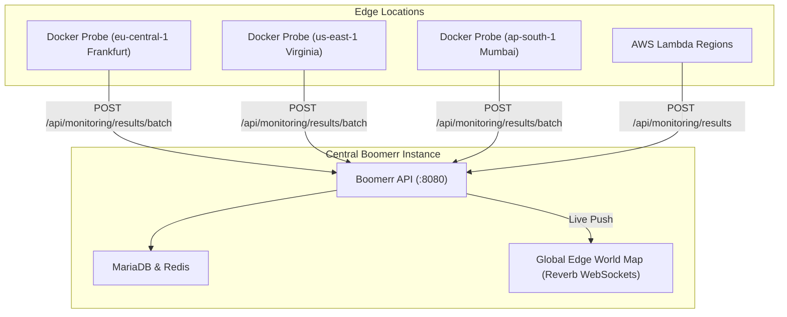

# 🌍 Global Edge Monitoring Guide

Boomerr includes built-in support for global edge monitoring: probing websites from multiple geographical locations, measuring regional latency, and aggregating health consensus across nodes.

---

## 🏗️ Architecture Overview

Boomerr supports 3 deployment architectures:

1. **Local Mode (Default, Zero Extra Setup)**: The central Docker worker monitors all domains directly from the host.
2. **Docker Edge Probes (Recommended for Self-Hosters)**: Run lightweight Docker probe containers on any cheap VPS worldwide.
3. **AWS Lambda (Serverless)**: Deploy serverless probe functions across AWS regions with AWS SAM.



---

## 🐳 Option 1: Deploy a Docker Edge Probe (Any VPS)

To monitor from a new geographical location (e.g. Europe, Asia, US):

### 1. Set `MONITORING_API_KEY` on Central Server
In your central Boomerr `.env`:
```env
MONITORING_API_KEY=your_super_secret_key_here
```

### 2. Launch Probe on Remote Server
On any remote machine with Docker:

```bash
docker run -d --name boomerr-probe --restart unless-stopped \
  -e BOOMERR_SERVER_URL="https://your-boomerr-server.com" \
  -e BOOMERR_API_KEY="your_super_secret_key_here" \
  -e PROBE_REGION="eu-central-1" \
  -e PROBE_LOCATION="Frankfurt (Germany)" \
  boomerr-probe:latest
```

The probe will immediately:
- Fetch active targets via `GET /api/monitoring/targets`.
- Probe each domain concurrently.
- Report batch latencies via `POST /api/monitoring/results/batch`.
- Send telemetry heartbeats via `POST /api/monitoring/heartbeat`.

---

## ⚡ Option 2: Deploy AWS Lambda Serverless Probes

For teams already on AWS:

1. Navigate to `probes/aws-lambda/`.
2. Deploy with AWS SAM to each desired region:
   ```bash
   sam deploy --guided --region us-east-1
   ```
3. Enable in central Boomerr `.env`:
   ```env
   MONITORING_LAMBDA_ENABLED=true
   AWS_ACCESS_KEY_ID=your_key
   AWS_SECRET_ACCESS_KEY=your_secret
   MONITORING_API_KEY=your_super_secret_key_here
   ```

---

## 🛡️ False-Alarm Prevention (Consensus Quorum)

When multiple edge probes report on a domain, Boomerr uses regional consensus before triggering alerts:
- **`MONITORING_MIN_HEALTHY_REGIONS=1`**: Minimum number of regions that must report UP for the domain to be considered globally healthy.
- **`MONITORING_FRESHNESS_WINDOW=2`**: Time window (in minutes) for regional check validity.
- **Median Response Time**: Boomerr calculates the median latency across reporting regions to eliminate regional outliers.

---

## 📋 Pre-Seeded Active Regions

| Code | Region Name | Coordinates |
|---|---|---|
| `ap-south-1` | Mumbai (India) | 72.87°E, 19.07°N |
| `us-east-1` | US East (Virginia) | 77.48°W, 39.04°N |
| `us-west-2` | US West (Oregon) | 119.41°W, 44.00°N |
| `eu-central-1`| Germany (Frankfurt) | 8.68°E, 50.11°N |
| `af-south-1` | Cape Town (South Africa) | 18.42°E, 33.92°S |
| `me-south-1` | Bahrain (Middle East) | 50.58°E, 26.06°N |
